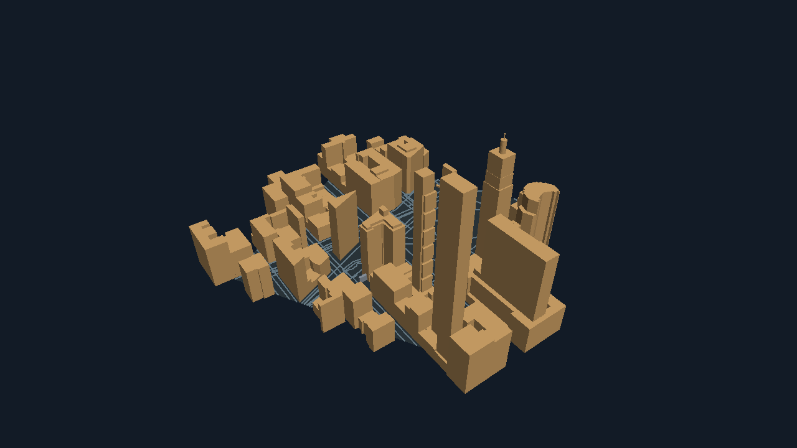

# ntmaps — Terminal OpenStreetMap widget for Bubble Tea

<p>
    <a href="https://github.com/NimbleTerminal/ntmaps/tags"></a>
    <a href="https://pkg.go.dev/nimbleterminal.dev/ntmaps"></a>
    <a href="https://github.com/NimbleTerminal/ntmaps/blob/main/CODE_OF_CONDUCT.md"></a>
</p>

`ntmaps` is a [Bubble Tea](https://github.com/charmbracelet/bubbletea) widget that renders OpenStreetMap tiles in the terminal. It fetches and composes XYZ tiles itself and renders them with [`ntpicture`](https://nimbleterminal.dev/ntpicture) — half-block glyphs anywhere, full-resolution Kitty graphics on terminals that support them (Kitty, Ghostty, WezTerm).

[Open the map explorer](https://nimbleterminal.github.io/ntmaps/?demo=explorer) ·
[Minimal 2D example](examples/mapview/main.go) ·
[Explorer sample app](examples/explorer/main.go)

## Quickstart

```sh
go get nimbleterminal.dev/ntmaps@latest
```

```go
package main

import (
    "fmt"
    "os"

    tea "charm.land/bubbletea/v2"
    "nimbleterminal.dev/ntmaps"
)

type model struct{ mv ntmaps.Model }

func (m model) Init() tea.Cmd { return m.mv.Init() }

func (m model) Update(msg tea.Msg) (tea.Model, tea.Cmd) {
    if k, ok := msg.(tea.KeyMsg); ok && (k.String() == "q" || k.String() == "ctrl+c") {
        return m, tea.Quit
    }
    if sz, ok := msg.(tea.WindowSizeMsg); ok {
        m.mv.SetSize(sz.Width, sz.Height)
    }
    var cmd tea.Cmd
    m.mv, cmd = m.mv.Update(msg)
    return m, cmd
}

func (m model) View() tea.View { return m.mv.View() }

func main() {
    mv := ntmaps.New(0, 0)
    mv.SetLatLng(40.6892, -74.0445, 13) // Statue of Liberty
    if _, err := tea.NewProgram(model{mv: mv}).Run(); err != nil {
        fmt.Println(err); os.Exit(1)
    }
}
```

Pan with arrows or `hjkl`, zoom with `+`/`-`. The widget owns those bindings — no parent wiring needed.

## Demo

The sample app lives at [`examples/explorer`](./examples/explorer/main.go), with a places list, tile-style cycling, and 2D/3D switching. The minimal widget host is [`examples/mapview`](./examples/mapview/main.go).

```sh
task build-ex-explorer
./bin/ntmaps-explorer
```

Arrows move two columns horizontally or one row vertically. The native
explorer animates them with a critically damped
[Harmonica](https://github.com/charmbracelet/harmonica) spring
(`ntmaps.Config{SmoothPan: true}`), targeting 60 updates per second; actual
display rate depends on the terminal and transport. Repeated arrows preserve
velocity and move the target; zooming or selecting a location cancels the
previous trajectory. Frames compose from the tile cache, and once a render
completes the ring of tiles beyond each edge is fetched in the background
(`Config.Prefetch`, one tile width by default, up to four, negative to
disable), so the next pan usually paints from memory. Kitty presentations run
one at a time: input that arrives mid-frame is queued and the latest image is
shown when the frame has been sent.

For a compatible local Kitty/Ghostty terminal, try shared-memory transport:

```sh
go -C examples run ./explorer -medium shm
```

The demo starts in Kitty rendering when the terminal supports it; press `g` to toggle. The default `-medium direct` also works
over SSH. Call `mv.Close()` after your Bubble Tea program exits to release
pending shared-memory images.

## Tile styles

`ntmaps.SetStyle(...)` switches between the built-in providers: `Wikimedia`, `OpenStreetMaps`, `OpenTopoMap`, `CartoLight`, `CartoDark`, `ArcgisWorldImagery`. Each comes with the upstream provider's terms-of-use and attribution requirements — read them before shipping a public app. The attribution strip drawn along the bottom of the map follows the selected provider.

Any XYZ tile server works through `ntmaps.SetTileSource` and the `nimbleterminal.dev/ntmaps/tile` package, including keyed services:

```go
mv.SetTileSource(tile.Provider{
    Name:        "thunderforest-outdoors",
    URL:         "https://{s}.tile.thunderforest.com/outdoors/{z}/{x}/{y}.png?apikey=" + key,
    Shards:      []string{"a", "b", "c"},
    Attribution: "Maps (c) Thunderforest; Data (c) OSM and contributors, ODbL",
    MaxZoom:     22,
})
```

`Name` keys the tile and render caches, so give distinct providers distinct names. A provider with an empty `URL` renders only its `Placeholder` color and fetches nothing, which is handy in tests.

Tile requests identify the application with a `User-Agent` of `ntmaps/<version> (+https://github.com/NimbleTerminal/ntmaps)`. Tile usage policies, [OpenStreetMap's](https://operations.osmfoundation.org/policies/tiles/) included, ask that a public app name itself, so set `Config.UserAgent` before shipping one. Browsers send their own, and the header is not set under WASM.

## Render modes

| Mode | What it does | Where it works |
|---|---|---|
| `ntmaps.RenderGlyph` (default) | Half-block ANSI from ntpicture | Any modern terminal |
| `ntmaps.RenderKitty` | Full-resolution image via Kitty graphics protocol | Kitty, Ghostty, WezTerm |

`mv.SetRenderMode(mode)` returns a `tea.Cmd` that re-renders at the new mode. Toggling away from Kitty automatically deletes the uploaded image so no ghost stays in the terminal.

To start in Kitty whenever it is available, set `ntmaps.Config{PreferKitty: true}`. The model begins in Glyph and switches once the terminal's Kitty-support probe succeeds; it never overrides a mode chosen with `SetRenderMode`.

The WASM browser demo requests Kitty shared-memory transport through booba v0.10.3 and starts in Kitty rendering; press `g` to switch to glyphs. Native demos default to direct transmission, including over SSH. Other consumers can opt in with `ntmaps.Config{KittyMedium: ntmaps.KittyMediumSharedMemory}` when their terminal or browser bridge supports it. Shared-memory allocation or bridge failures fall back to direct transmission.

## Bubble Tea version

Targets Bubble Tea **v2** (`charm.land/bubbletea/v2`). No v1 backport.

## Routing messages across multiple picture owners

`ntmaps.IsMapUpdate(msg)` is a **"may need this"** predicate, not an ownership predicate. It returns `true` for both the widget's own messages *and* for every `legacy.IsPictureMsg` (Kitty frames, cell-size events, capability probes). Picture messages are program-wide — they belong to the runtime, not to any one model.

If your program embeds `picture.Model` in more than one place (say, a `ntmaps.Model` *and* a `pictureurl.Model` rendering a product image), do NOT route picture messages with `else if` — broadcast them to every picture owner, otherwise one of them will starve:

```go
mapMsg := ntmaps.IsMapUpdate(msg)
prodMsg := pictureurl.IsPictureMsg(msg)

if mapMsg || prodMsg {
    var cmds []tea.Cmd
    if mapMsg {
        var cmd tea.Cmd
        m.mv, cmd = m.mv.Update(msg)
        cmds = append(cmds, cmd)
    }
    if prodMsg {
        var cmd tea.Cmd
        m.prod, cmd = m.prod.Update(msg)
        cmds = append(cmds, cmd)
    }
    return m, tea.Batch(cmds...)
}
```

For the narrower "is this message owned by ntmaps alone" predicate (the `MapCoordinates` input, async tile-render results, debounce ticks), use `ntmaps.IsMapOwnMsg(msg)`. Each model's own `Update` already filters by instance ID where applicable, so broadcasting picture messages is safe.

## Examples and sample application

| Program | Purpose |
| --- | --- |
| `mapview` | Minimal 2D map widget host: pan, zoom, marker, glyph/Kitty toggle |
| `explorer` | Places browser with a details pane and switchable 2D / 3D buildings |
| `cityview3d` | Standalone development viewer for the internal city helpers |
| `mapview3d` | Flat textured-map rendering and performance fixture |

The small 2D example keeps application concerns out of the embedding code:

```sh
task build-ex-mapview
./bin/ntmaps-mapview -lat 40.7415 -lon -73.989 -zoom 16
```

### Map explorer

The richer places/list UI lives in `examples/explorer`. It starts at Flatiron,
Manhattan; the first 3D neighborhood is bundled and works without network access.

```sh
task build-ex-explorer
./bin/ntmaps-explorer
```

Press **`v` to switch 2D/3D**, `j`/`k` or Shift-Up/Down to choose a place, and `/`
to filter the list. Filtering owns keyboard input until accepted or canceled.
Arrows pan in 2D and orbit/tilt in 3D. In 3D, WASD moves, E/F rises/lowers,
`+`/`-` zooms, `0` resets the camera and `t` switches GPU/software. In 2D, `s`
changes map/satellite style, `f` cycles fit, and `[`/`]` changes optical zoom.
`g` toggles glyph/Kitty output in either view; `?` expands the help.

Mouse controls work inside the active map pane: drag to pan in 2D, drag to
orbit in 3D, Shift-drag to pan the 3D camera, and scroll to zoom. Click or scroll
in the places list to select a place. Borders/status rows do not receive map
zoom gestures, and releasing outside the pane ends the drag. The app enables
terminal mouse reporting in both native and browser sessions.

Switching preserves the geographic center. Returning from 3D moves the 2D map
to the city camera's ground target. Moving within an already loaded neighborhood
reuses the city geometry. Selecting a different place loads a small neighborhood
around that point; obsolete requests are canceled and stale results are ignored.
The app shows loading/error feedback instead of displaying the previous city's
buildings under a new place name. It does not stream new areas during flight.

Neighborhood scenes use a bounded in-memory cache. Native runs additionally
cache source data under the OS user-cache directory at
`ntmaps/neighborhoods-v1`: up to eight files / 32 MiB, expiring after seven
days. Use `-cache-dir PATH` to choose a directory, or `-cache-dir ''` to disable
disk storage. The browser uses memory only. Uppercase **`R` explicitly refreshes**
the current 3D neighborhood; `-offline` allows only cached/bundled data. The bundled
sample is seeded in memory even without a cache directory; normal LRU eviction
still applies as other neighborhoods are loaded.

3D data loads use OpenStreetMap's read API with bounded area/response size and a
deadline. Raw geographic data, mesh generation, rendering, and app caching remain
separate internal pieces; no new public library API is introduced.

## Flat textured-map fixture

The `mapview3d` example displays `ntmaps.Image()` on an unlit ntcharts3d
surface. It is a flat map in 3D, without terrain elevation. Camera movement
reuses the texture; panning or changing map zoom updates it.

```sh
go -C examples run ./mapview3d -medium shm
```

Use arrows to tilt and rotate, WASD to pan the map, `[` / `]` for map zoom,
and `+` / `-` for camera zoom. `n` / `p` select places, `0` resets the camera,
`r` toggles rotation, `o` switches projection, and `g` toggles glyph/Kitty output.
Press `t` to switch between software and GPU rendering without restarting. The
status line shows the active renderer and, if it falls back, the requested mode
and any rendering error. Switching renderers preserves the map and camera.

Software rendering is the default. Add `-renderer gpu` to request WebGPU:
`go -C examples run ./mapview3d -renderer gpu`. Native GPU backends are included
without an extra build tag. ntcharts3d falls back to software if GPU rendering fails.
The `webgpu` tag enables opt-in GPU tests and benchmarks; run
`task bench-mapview3d-gpu` to measure GPU snapshots (the benchmark rejects fallback).
Use `-medium direct` (the default) over SSH. Build a native binary with
`task build-ex-mapview3d`.

## Experimental city viewer

`cityview3d` explores actual building footprints and heights. It starts with a
bundled OpenStreetMap sample around Flatiron in Manhattan, so no network request
is needed. It requests GPU rendering by default, with software fallback.

```sh
task build-ex-cityview3d
./bin/ntmaps-cityview3d
```

Arrows orbit/tilt the camera; WASD moves the camera target along the ground,
E/F raises/lowers it, `+`/`-` zooms, `0` resets, and `t` switches GPU/software.
`g` switches glyph/Kitty output. Only the loaded neighborhood is drawn; moving
farther does not fetch more data. Flight has no collision detection.

Building colors describe height provenance: orange uses a recorded height,
blue estimates from floor counts, and gray uses a 9-meter default. Flat roofs,
flat ground and road centerlines form the first scaffold. Courtyard relations,
open/incomplete ways and invalid footprints are omitted and counted in the HUD.

Load a local OSM Map API/Overpass JSON file with `-file path.json`. An optional
top-level `bounds` object uses `south`, `west`, `north`, `east`; otherwise supply
`-lat`, `-lon`, and `-radius` to describe its neighborhood. Overpass geometry must
be complete, not clipped. A single live neighborhood fetch is explicit:

```sh
./bin/ntmaps-cityview3d -osm -lat 40.7415 -lon -73.989 -radius 200
./bin/ntmaps-cityview3d -snapshot /tmp/city.png
```

The helpers live in [`internal/city`](internal/city/README.md), with no rendering
dependencies or public API commitment. The Tea pane and chart adapter are shared
by this development viewer and the explorer in `examples/internal/cityview`. The
standalone viewer remains native; the explorer is included in the browser site. The bundled data's source and
attribution are recorded in [examples/cityview3d/DATA.md](examples/cityview3d/DATA.md).



## Known caveats

- **WASM dependencies.** `wasm.work` selects Bubble Tea and clipboard forks with browser support. Native builds use upstream versions. The WASM task and CI select this workspace automatically; manual builds need `task build-wasm` (or select that workspace with `go -C examples build`).
- **Progressive tile rendering.** A render paints the tiles already in memory, fetches the rest, and repaints as they land (batched to about ten repaints per second), keeping the Loading badge up until the last tile arrives. Panning across tiles seen before composes synchronously with no fetch and no badge. Tiles live in a per-Loader memory LRU (`Config.TileCacheCap`, default 256 tiles) and, natively, a raw-bytes disk cache under the user cache directory (`Config.TileCacheDir`, `Config.DisableDiskCache`); pass one `Config.Loader` to several models to share both. A newer render cancels the fetches of the one it supersedes, except for tiles both need. Downloads share one concurrency limit, so a background prefetch never starves the render on screen. Composited viewports are kept in a small per-Model LRU keyed on `(lat, lng, zoom, cols, rows, provider, oversample, markers)` — revisiting a state hits the cache synchronously. Default cap is 16 entries; tune via `ntmaps.NewWithConfig(Config{CacheCap: N})` (`-1` disables this LRU). Spring-animation frames bypass it. Hosts that snapshot the first frame should wait until no render is in flight, since it may show placeholder tiles.
- **Server-side supersample (`Config.Oversample`).** Raises the source-image pixel density without changing visible geographic coverage — `Oversample: N` (powers of 2) renders the same area at `N×` per-cell resolution and `+log2(N)` OSM tile zoom, so Kitty terminals can downscale a sharper source. `1` (default) keeps current behavior; `2` is a noticeable boost; `4` is hi-DPI quality at ~16× the tile fetches. Capped so the effective tile zoom never exceeds the provider's `MaxZoom`. Glyph mode pays the cost without visible benefit.
- **Client-side optical zoom (`Config.OpticalZoom` / `mv.SetOpticalZoom(n)`).** Magnifies the *cached* source image by cropping the center `1/2^n` of each axis and letting the renderer scale it back up to the cell rectangle. No network, no tile-render goroutine — switching is instant. Pixelated at high N (it's digital zoom in spirit even though we call it optical), but useful for going past the OSM tile-zoom ceiling or just inspecting fine detail without re-fetching. Composes with `Oversample`: e.g. `Oversample: 2` + `OpticalZoom: 1` is a 2× zoomed view rendered from a 2× supersampled source.
- **Aspect-ratio guardrail (`Config.MaxAspectRatio` / `Config.LetterboxColor`).** Maps display correctly at any cell-rect AR — every pixel sits at its true geographic location — but at extreme ARs (a 100×5 status bar, say) viewers find the result disorienting because their mental model of "a map" is roughly square. `MaxAspectRatio: 3.0` lets the cell rect's AR range up to 3:1 in either direction; beyond that, the map portion is rendered at the boundary AR centered in the cell rect, with the rest filled by `LetterboxColor` (default opaque black; `color.Transparent` shows the terminal background through the bars). The letterbox is composed into the source image *before* picture renders, so Glyph and Kitty show identical letterbox geometry — toggling render modes doesn't change layout. Default `0` keeps the current "fill the cell rect at any AR" behavior; opt in when your layout might land in extreme territory.
- **Geocoding uses Nominatim** with no caching. Respect their [usage policy](https://operations.osmfoundation.org/policies/nominatim/) for production traffic.

## License

Many thanks to the **OpenStreetMap Foundation** ([donate](https://supporting.openstreetmap.org/donate/)).

[MIT License](./LICENSE.txt) — Copyright (c) 2026 [Neomantra Corp](https://www.neomantra.com).

----
Made with :heart: and :fire: by the team behind [Nimble.Markets](https://nimble.markets).

## Development and browser demos

The root module contains the map widget. `examples/go.mod` owns ntcharts3d
v0.3.2 (with nt3d v0.3.1) and go-booba v0.10.3; library users do not inherit the demo or GPU
dependencies. ntcharts3d uses published nt3d and ntpicture modules. The root
module path is `nimbleterminal.dev/ntmaps`, hosted at
[github.com/NimbleTerminal/ntmaps](https://github.com/NimbleTerminal/ntmaps).

Run `task test` for both modules, `task build` for native binaries, and
`task ci` for race tests, vet, dependency checks, native builds, and browser
smoke tests. Build the browser site with `task build-wasm-site`, then serve it
with `task serve-wasm-site`. The landing page offers the explorer, minimal 2D map, and flat-map fixture, with action
buttons, renderer selection, and restart. Generated assets are ignored.
GitHub Pages deploys only after the same CI checks pass.

After changing dependencies, run `task go-tidy` and `task notices`. Browser
builds use `wasm.work`; native tasks explicitly disable workspaces.

See [migration notes](MIGRATION.md) for the compatibility adapter, the upstream
glyph-cache regression, and suggested platform guide corrections.

For reproducible 3D CPU benchmarks, run `task bench-mapview3d`. See the
[performance baseline](examples/mapview3d/PERFORMANCE.md) for timings, allocation
profiles, and measurement limits.
